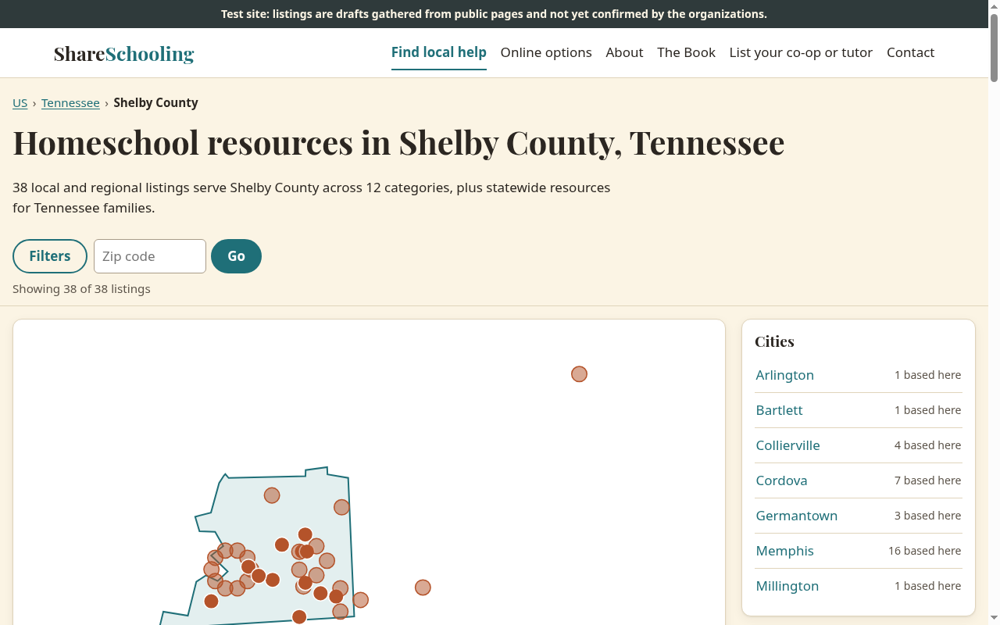
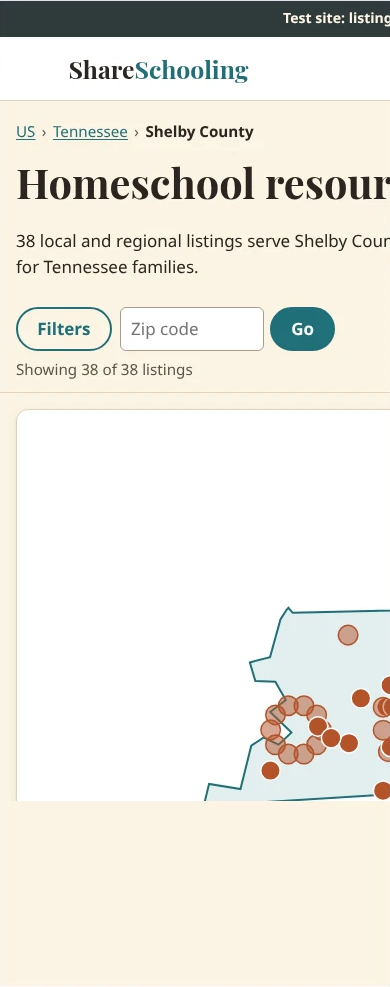
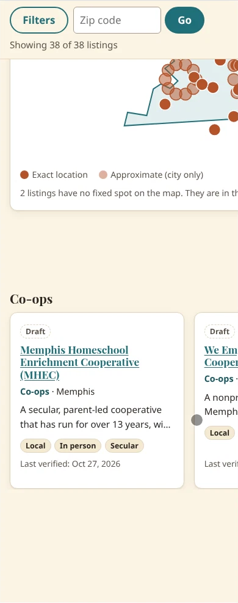
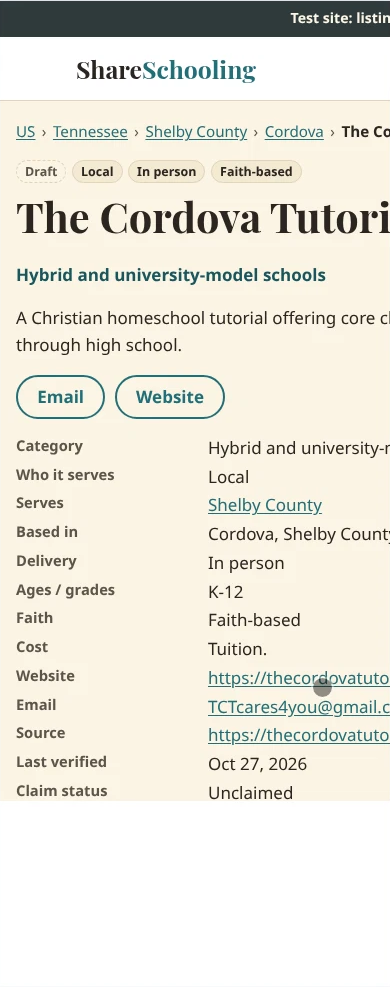

# Map navigation brief for Claude

Prepared November 17, 2026 for the ShareSchooling prototype (`DParkerson7/shareschooling-prototype`, test site at https://dparkerson7.github.io/shareschooling-prototype/).

**This pull request is a brief and review screenshots only.** It does not change site code, generated pages, or listing data. **David reviews this brief first.** After he approves it, Claude should implement the changes on a separate branch and open a follow-up pull request. Nothing goes live on a production domain without David's approval. Hosting stays on the GitHub Pages test site.

This brief sits next to `docs/map-pilot/claude-brief.md`, which covered the West Tennessee plus DeSoto County, MS pilot build. That work is on the test site. This document covers only map navigation and mobile layout, so parents can actually use the map as the nationwide clearinghouse grows state by state.

## 1. How the map is built today

The site is static HTML generated by `tools/build_site.py` and served from the repository root. Interactive behavior lives in `js/site.js`. Colors and typography are in `css/theme.css`; layout is in `css/styles.css`. State and county shapes come from `data/map.json`. Listings come from `data/listings.json`. Zip lookup uses `data/zips.json` and `data/county-routes.json`.

The map is a custom SVG, not Leaflet or Mapbox. There is no zoom, pan, clustering, or marker popup in the current code.

| Piece | File and function | What it does |
| --- | --- | --- |
| US map | `tools/build_site.py` → `us_map_svg()`, used by `build_home()` | Linked state shapes. Pilot states get `pilot-state` (TN) or `pilot-partial` (MS) classes. |
| State county map | `state_map_svg()`, used by `build_pilot_state()` | Counties shaded by listing count (`shade()` / `pilot-1` through `pilot-4`). Clicking a county goes to that county page. |
| County / city pin map | `county_map_svg()` and `pins_svg()`, used by `build_pilot_county()`, `build_city()`, and `build_listing()` | One `<circle class="pin">` (or `pin approx`) per listing with coordinates, wrapped in an `<a href>` to the listing detail page (`data-pin="{id}"`). |
| Filters, count, zip | `filter_bar()` in `tools/build_site.py`; `initFilters()`, zip submit handler, and `sortByDistance()` in `js/site.js` | Category, Who it serves, Delivery, and Faith filters. The count is written to `[data-results-count]` as "Showing X of Y listings". Zip "Go" navigates to the matching county page with `?zip=` and then sorts the list by distance. |
| "Hide map" | `filter_bar(..., with_map=True)` and the Map / list toggle section in `js/site.js` | On viewports under 900px, a button toggles `hidden` on `#map-area`. Hidden on desktop (`.map-toggle` in `css/styles.css`). |
| Breadcrumbs | `crumbs_for()` / `breadcrumbs()` | US → state → county → city → listing. |
| Pin and map styles | `css/styles.css` (Maps section) and `css/theme.css` (`--color-pin`, `--color-pin-stroke`, `--color-map-*`) | Exact pins use `--color-pin` (`#b4532a`). Approximate pins use `.pin.approx` at 50% fill opacity. |

`pins_svg()` already fans out pins that share the same rounded lat/lon (city-precision pins stacked on a city centroid). Nearby pins that are not at the same coordinate still overlap, and there is no way to zoom in, so the fan-out is not enough in dense areas.

Implementation should keep going through `tools/build_site.py` plus `js/site.js` and CSS, then regenerate pages, so every state, county, city, and listing page stays consistent. Do not hand-edit generated HTML as the source of truth.

## 2. What the review found (November 17, 2026)

Reviewed on the live test site at https://dparkerson7.github.io/shareschooling-prototype/, on a desktop viewport and at about 390px wide (phone). Screenshots are in `docs/map-pilot/map-ux/`.

### Current structure (working as designed)

- The homepage is a US map. Each state is a link. Tennessee is labeled as the live pilot; Mississippi is a partial pilot (DeSoto County). See `map-ux/desktop-landing.png`.
- The Tennessee page is a county map shaded by number of listings, with a "Pilot counties" list beside it. See `map-ux/desktop-tennessee-county-map.png`.
- The Shelby County page has one small rust-colored dot per listing. Dark rust is "Exact location"; pale rust is "Approximate (city only)". Beside the map is a list of cities with counts (Memphis 16, Cordova 7, and so on), plus nearby counties. Resource cards below are grouped by category. Filters cover Category, Who it serves, Delivery, and Faith. The count reads "Showing 38 of 38 listings" (or "Showing 4 of 38 listings" when filters are on). A Zip code box with a Go button sits in the filter bar. On phones there is a "Hide map" button. See `map-ux/desktop-crowded-map.png`, `map-ux/desktop-map-legend-and-cities.png`, and `map-ux/desktop-filter-panel.png`.

### High: dots are crowded and easy to miss-tap

Around Memphis and Cordova, pins sit on top of each other. In the review, clicking "Bellevue Tutorial" hit a different marker and opened "The Cordova Tutorial". There is no clustering. Marker color and shape do not show the resource type; every pin is the same rust circle, varying only by exact vs. approximate opacity.

`pins_svg()` in `tools/build_site.py` is the code to change. Pins are also not large enough as tap targets (radius is the map size divided by 55).

### High: no zoom or pan controls

The SVG is a static picture. There are no + / − buttons, no drag-to-pan, and no pinch-to-zoom. Scrolling over the map scrolls the page. Dragging the map does nothing. The only way to change what you see is to follow links (state, county, city, breadcrumb, or zip search, which jumps to a county page rather than moving the current map).

### High: the phone layout overflows sideways at about 390px

At about 390px wide, page text, the county map, and listing cards run off the right edge. The map and dots are clipped, the city list ends up off screen, and the page title is cut off ("Homeschool resour…"). The listing detail page also overflows: the title, breadcrumb, field values, and long URLs are clipped. Overflow was observed at about 390px. It was not measured at the other widths in the 360–430px band. That band is the proposed acceptance range in change 1: after the fix, nothing should require horizontal scrolling from 360px through 430px.

Likely contributors in `css/styles.css` include `.card-grid` (`repeat(auto-fill, minmax(260px, 1fr))`, which can force a column wider than a narrow phone), long unwrapped strings (the test-site banner, titles, website URLs), and the map panel not clipping or shrinking its SVG cleanly. Fix the layout rather than hiding overflow without making the content usable.

### Medium: tapping a dot goes straight to the detail page

Each pin is an `<a href>` to the listing page, generated in `pins_svg()`. There is no preview popup. After a miss-tap (as with Bellevue Tutorial vs. The Cordova Tutorial), the only way back is the browser back button or the breadcrumb. See `map-ux/desktop-marker-detail.png`.

List cards and map pins are not linked in the other direction either: tapping a card does not highlight its pin, and tapping a pin does not highlight its card.

### Medium: the legend only explains location precision, and the map has a lot of empty space

The county-map legend in `build_pilot_county()` only explains exact vs. approximate location. It does not explain resource types. The county shape is compact, but `county_map_svg()` pads the view box and the panel is tall (`max-height: 440px` on the SVG), so there is a large field of empty white space around the county, with a few outlying pins. See `map-ux/desktop-map-legend-and-cities.png`.

## 3. Requested changes

Implement these in priority order. They must work on every state, county, city, and listing map, not only Tennessee and Mississippi, because the clearinghouse will grow state by state.

### 1. Fix the phone layout so nothing scrolls sideways

**Priority:** High.

Sideways overflow was observed at about 390px. The proposed acceptance range is 360px to 430px, so the fix is checked across that band and not only at the width where it was seen. At those viewport widths, the map pages, listing list, and listing detail pages must stay within the viewport. No horizontal scrollbar, no clipped titles, no clipped map, no cards or city lists hanging off the right edge.

**Acceptance criteria:**

- At the proposed acceptance widths of 360px, 390px, and 430px (390px is where overflow was observed; 360px and 430px are the edges of the range), the homepage, a pilot state page, a pilot county page (use Shelby County as the test), a city page, and a listing detail page (including one with a long website URL) have no horizontal overflow.
- Text, including headings, breadcrumbs, the test-site banner, field values, and URLs, wraps or otherwise stays on screen.
- The county map scales to the content width; pins and the county outline are not clipped unless the user has zoomed in (see change 3).
- Listing cards stack in a single column on these widths.
- Desktop layout (from the existing 900px / 1000px breakpoints) still shows the map beside the city list and the cards in a multi-column grid.

### 2. Add marker clustering

**Priority:** High.

Nearby dots should merge into numbered bubbles that split apart as the user zooms in. This is the fix for the Memphis / Cordova pile-up and for the Bellevue Tutorial / Cordova Tutorial miss-tap.

**Acceptance criteria:**

- At the default county zoom, overlapping or tightly grouped pins (Memphis and Cordova on Shelby County are the test case) render as cluster bubbles with a count, not as a stack of individual dots.
- Zooming in (change 3) splits clusters until individual pins appear. Zooming out merges them again.
- Tapping a cluster zooms the map to show its members, or expands them enough to tap separately. It must not be possible to tap one listing and open a different listing's page.
- Filters still hide pins and clusters that have no visible listings. A cluster count reflects only the listings that pass the current filters.
- City-centroid "approximate" pins may still use a modest fan-out once a cluster has split, so several city-only listings in the same town remain distinguishable.
- The same clustering runs on every county and city map, including future states with dense cities.

### 3. Add zoom and pan

**Priority:** High.

Add + and − buttons, plus pinch and drag. Fit the initial view to the listings. Scrolling the page must not get trapped by the map.

**Acceptance criteria:**

- Visible + and − controls on county and city maps (and on the small map on a listing detail page, if that map is made zoomable). Controls are usable with a mouse, a keyboard, and a 44px-plus tap target on phones.
- The user can drag to pan and pinch to zoom on touch devices. On a desktop trackpad or mouse wheel, prefer zooming the map only when the map is focused or when a modifier is held, so ordinary page scrolling is not captured. If the map has focus, provide a clear way to scroll the page instead (for example, a "use scroll to zoom" hint, or letting scroll pass through until the user clicks the map).
- The default view fits the county (or city) listings, including pins that sit just across a county or state line, without the large unused white field around a compact county shape. Outlying pins should still be reachable by pan/zoom, but the starting view should be tight enough that the county is readable.
- After filters change, the map may refit to the remaining pins or leave the current view; either is fine as long as remaining pins are not left completely off-screen without a way to reach them (a "Fit to results" control is acceptable).
- State and US overview maps may stay static clickable SVGs, as they are today, unless zoom/pan there is a natural byproduct. Do not block the existing click-to-drill-down behavior.

### 4. Open a preview card when a pin is tapped; keep map and list in sync

**Priority:** Medium.

Tapping a dot should open a preview on the map (name, category, city, and a "View details" link) that is easy to close. Tapping a list card should highlight its dot, and tapping a dot should highlight its card.

**Acceptance criteria:**

- Tapping or clicking a single pin opens a preview on the map. It does not navigate away from the county or city page.
- The preview shows at least the listing name, category, and city, plus a "View details" link to the existing listing page.
- The preview is easy to close: a close control, the Escape key, and clicking or tapping empty map space all dismiss it.
- Tapping a listing card (or a focus/hover equivalent that works on touch) highlights or selects its pin, pans or zooms enough for that pin to be visible, and may open the same preview. Tapping a pin highlights the matching card and scrolls it into view if needed.
- Miss-taps no longer open the wrong listing. If two pins are still close after clustering and zoom, the preview or a short disambiguation list must make the choice explicit.
- Keyboard and screen-reader users can reach the same preview (pins remain focusable and labeled). The current `aria-label` on the pin link, including the "approximate location" wording, should be preserved or improved.

### 5. Give markers a color or icon per resource type

**Priority:** Medium.

Markers should use a color or icon for each resource type. Add that to the legend. Keep the exact-vs-approximate distinction in a secondary way. Tap targets should be at least 44px on phones.

**Acceptance criteria:**

- Each category in `data/listings.json` → `categories` (co-ops, tutors, field trips, umbrella schools, and the rest) has a distinct color and/or icon. The system stays readable with more than a dozen categories and still works if a later state adds a category.
- The map legend shows the resource-type symbols, and still shows exact vs. approximate location as a secondary cue (for example stroke, fill opacity, or a second small mark). Do not drop the precision distinction; just stop using it as the only visual difference.
- On phones, the tappable area for a pin or cluster is at least 44×44 CSS pixels, even if the visible icon is smaller.
- Filtered-out types do not linger in a way that contradicts the visible pins; the legend may dim unused types or continue to show the full key.

### 6. Make search come first

**Priority:** Medium.

The ZIP or city box should jump to and center the map. Keep the existing filters and the count. On phones, offer a list/map toggle.

**Acceptance criteria:**

- Search is visually first in the tool bar: a ZIP or city field is obvious without opening Filters. City search can be a second mode in the same box or a clearly labeled companion field.
- Submitting a ZIP or city in scope jumps to the right state/county page if needed, then centers (and zooms) the map on that place. Distance sorting of the list, already implemented in `sortByDistance()` in `js/site.js`, can remain.
- A ZIP or city outside current coverage still gets a clear "not in the map yet" message (today's zip handler in `js/site.js` already does this for unknown zips; extend that idea to city search, and keep the wording maintainable as more states go live).
- Filters (Category, Who it serves, Delivery, Faith), "Clear filters", the "Showing X of Y listings" count, and filter state in the URL query string all stay.
- On phones, the user can switch between a list view and a map view, not only hide the map while the list stays underneath. The existing "Hide map" button (`[data-map-toggle]`) can be extended into this toggle, as long as both modes are obvious and the choice persists while the user stays on the page. Desktop can keep showing map and list together, as it does now.

## 4. What to keep

Do not remove or bypass these. They are working parts of the pilot.

- The Filters panel and all four filter groups (Category chips, Who it serves, Delivery, Faith), including the "Some listings haven't told us yet. Those appear under All." note and "Clear filters".
- The "Showing X of Y listings" count (`[data-results-count]` in `js/site.js`).
- The city list with per-city counts on county pages, and the nearby-counties list.
- Breadcrumbs (`crumbs_for()`).
- The "Hide map" control on small screens, evolved as needed into the list/map toggle in change 6, and still hidden on the desktop layout.
- The US → state → county → city drill-down, including clickable state and county shapes.
- The note about listings with no fixed spot on the map (the hint in `build_pilot_county()` that N listings have no pin and appear in the list only). Those listings stay in the list and stay off the map.
- Draft / needs-verification notes, featured treatment, and the "Also available" statewide column, as specified in `docs/map-pilot/claude-brief.md`.
- The existing theme tokens in `css/theme.css`. New marker colors should be added there, not scattered as one-off hex values.

## 5. Scope and constraints

- **Nationwide, not a Tennessee-only patch.** Clustering, zoom and pan, previews, typed markers, search, and the phone layout must be built into the shared generator and scripts so a later state gets them automatically.
- **Do not change listing content** in `data/listings.json` or `docs/map-pilot/listings.json` as part of this work, unless a tiny technical field is required to support clustering or search and is called out in the implementation PR.
- **Do not hand-edit generated county or listing HTML as the source of truth.** Change `tools/build_site.py`, `js/site.js`, and the CSS, then run `python3 tools/build_site.py`.
- **Stay on the GitHub Pages test site.** David approves any later publish to a production domain.
- **This brief's pull request must not be merged with site-code changes.** Implement in a follow-up PR after David reviews this document.
- A mapping library (for example Leaflet) is acceptable if it keeps the site usable as static files on GitHub Pages, with no paid API key required for basic pan, zoom, and clustering. If you stay with the custom SVG, it must still meet every acceptance criterion above. Either way, keep using `data/map.json` shapes and the existing Albers USA projection in `project()` unless you document a replacement that still fits the US, state, and county drill-down.

## 6. Suggested test pass

After implementation, walk through at least:

1. Homepage → Tennessee → Shelby County, on desktop and at the proposed acceptance widths of 360px, 390px, and 430px. Overflow was observed at about 390px; 360px and 430px are the edges of that range.
2. Shelby County: confirm Memphis and Cordova cluster, that zooming splits them, and that Bellevue Tutorial and The Cordova Tutorial can each be opened on purpose, not by a miss-tap.
3. Zip `38117` (or another Memphis-area zip in `data/zips.json`) from the homepage and from the county filter bar: the map centers on that area and the list can still sort by distance.
4. A city search for "Cordova" and a city-page visit to `/tn/shelby-county/cordova/`.
5. Filters that reduce the count (for example a single category until the count reads "Showing 4 of 38 listings"): pins, clusters, and the count stay in sync.
6. A listing with no pin still appears in the list and is mentioned by the "no fixed spot" note.
7. A listing detail page does not overflow at about 390px, where overflow was seen, or at the 360px and 430px edges of the proposed acceptance range, and its breadcrumb still leads back.
8. DeSoto County, MS, plus one coming-soon state and one coming-soon county, to confirm the drill-down and empty states still work.
9. Keyboard-only use of zoom controls, pin focus, preview close (Escape), and filters.

## 7. Screenshots from the November 17, 2026 review

All files are in `docs/map-pilot/map-ux/`. Phone screenshots were taken at about 390px, where sideways overflow was observed. The 360–430px figures elsewhere in this brief are the proposed acceptance range, not additional widths that were measured in this review.

| File | What it shows |
| --- | --- |
| `desktop-landing.png` | Homepage US map; TN live pilot, MS DeSoto County pilot. |
| `desktop-tennessee-county-map.png` | Tennessee county map shaded by listing counts. |
| `desktop-crowded-map.png` | Shelby County pin pile-up around Memphis and Cordova; city list beside the map. |
| `desktop-map-legend-and-cities.png` | Exact vs. approximate legend, "2 listings have no fixed spot" note, empty space around the county shape. |
| `desktop-filter-panel.png` | Filters for Category, Who it serves, Delivery, and Faith, plus the results count. |
| `desktop-marker-detail.png` | After a pin click: the listing detail page, no map preview. |
| `phone-shelby-top.png` | ~390px: title and map clipped on the right. |
| `phone-shelby-map-and-list.png` | ~390px: legend, map, and cards overflowing sideways. |
| `phone-listing-detail.png` | ~390px: listing detail page overflowing sideways. |
